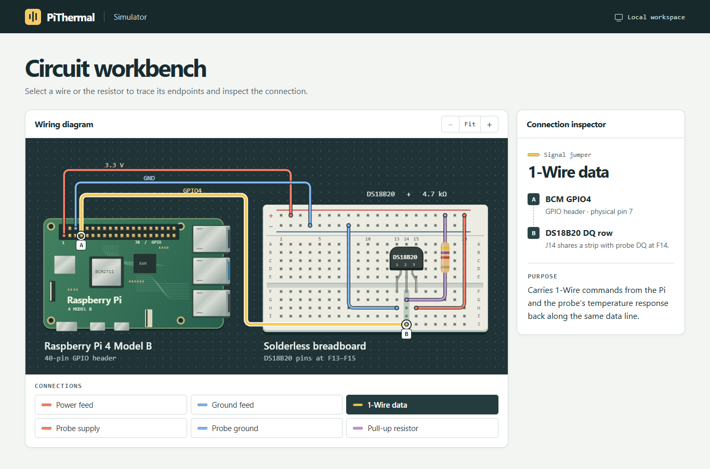

# PiThermal Simulation

An offline classroom simulator for **Operating Systems CCA · Project 13 · Raspberry Pi Temperature Monitoring System**. The circuit workbench lets a student trace the physical wiring from a Raspberry Pi 4B to a DS18B20 probe. Later phases connect that circuit to the hardware project's Python temperature monitor.

**Current status — Phase 1 ready for review.** Click any of the five jumper wires or the pull-up resistor. Rings **A** and **B** mark its two terminals, and the inspector identifies the pins, breadboard contacts and electrical purpose. The real sensor reader and monitor live in the [companion hardware repository](https://github.com/guptavernit2-afk/pithermal-hardware).

## Run the circuit workbench

From the root of this checkout, start Python's local file server:

```sh
python -m http.server 8765 --bind 127.0.0.1 --directory web
```

Open [the circuit workbench on this laptop](http://127.0.0.1:8765/). Use `python3` if that is the name of your Python 3 executable. A modern browser and this checkout are enough to run Phase 1 offline. Stop the server with Ctrl+C.

Click a wire on the diagram, or Tab to its connection button and press Enter or Space. Try **1-Wire data** followed by **Pull-up resistor**. Both reach the DQ strip, but their other ends and purposes differ. Use **+** to enlarge the board, scroll to inspect its holes, and choose **Fit** to restore the whole drawing.



## The classroom demo

Wire selection is available in Phase 1. The remaining rows describe the planned sensor and terminal interactions for Phases 2 and 3.

| What the presenter does | What the audience should see |
| --- | --- |
| Select the data wire | Both endpoints light up. Labels identify the probe's DQ pin and the Pi's GPIO4. |
| Set the slider to 27.5°C | The sensor file contains `27500`. On its next sample Python prints `27.500 °C  NORMAL` with a timestamp. |
| Set exactly 30°C, then 31.25°C | With the default 30°C threshold, Python first prints `NORMAL`, then `31.250 °C  WARNING`. |
| Press **Cool probe** | The simulated temperature falls gradually. The warning clears on the first sample at or below 30°C. |
| Disconnect the probe, then reconnect it | The sensor file disappears, Python prints `SENSOR ERROR`, and valid readings resume in the same process after reconnection. |

The slider gives the presenter exact values for boundary tests. **Warm probe** and **Cool probe** will change the simulated temperature gradually for a hands-on demonstration. The screen will identify the readings as simulated.

## Circuit wiring

The workbench shows a Raspberry Pi 4 with its 40-pin header, one three-pin DS18B20, a breadboard and a 4.7 kΩ pull-up. On this board each numbered strip from F through J is connected internally. For example, a jumper in J14 reaches the probe's DQ pin in F14. The selected strip is shaded between these contacts.

| Select | A | B | Purpose |
| --- | --- | --- | --- |
| Power feed | Pi 3.3 V, physical pin 1 | + rail, hole 2 | Supplies the positive rail. |
| Ground feed | Pi GND, physical pin 6 | − rail, hole 4 | Establishes the ground reference. |
| 1-Wire data | BCM GPIO4, physical pin 7 | J14 → DQ at F14 | Carries commands and temperature responses. |
| Probe supply | + rail, hole 20 | H15 → VDD at F15 | Supplies the probe with 3.3 V. |
| Probe ground | − rail, hole 8 | H13 → GND at F13 | Returns current to the Pi's ground. |
| Pull-up resistor | + rail, hole 18 | G14 → DQ at F14 | Holds the idle data line high through 4.7 kΩ. |

The pin map and sensor connections follow the component datasheets. Voltage measurement, 1-Wire electrical timing and the physical probe's response to heat belong to the bench investigation. [Raspberry Pi 4 Model B datasheet, §5.1](https://datasheets.raspberrypi.com/rpi4/raspberry-pi-4-datasheet.pdf) · [DS18B20 datasheet](https://www.analog.com/media/en/technical-documentation/data-sheets/DS18B20.pdf)

## Reproduce the Phase 1 browser checks

Keep the local server running. For automated checks, use Node.js 20 or later and an installed Edge (Windows default) or Chrome (macOS/Linux default). In a second terminal at the repository root, install the browser test tool once and run the suite:

```sh
npm --prefix tests ci
npm --prefix tests test
```

The test dependency is limited to the `tests/` folder. To use Chrome on Windows, set `$env:PITHERMAL_BROWSER_CHANNEL = "chrome"` in PowerShell before running the tests.

**Phase 1 result on Windows: 9/9 passed in Edge and 9/9 in Chrome.** The checks click the drawing at independently specified positions, compare the two visible rings against the expected terminal coordinates, and check the inspector text. They also cover the resistor lead, keyboard selection, zoomed wire picking on a narrow screen, and loading with external requests blocked.

## How a slider movement reaches Python

1. **Browser.** The presenter changes the virtual probe's temperature. A local Python service receives the value.
2. **Virtual device.** The service converts °C to whole millidegrees and updates a temporary file such as `<devices-dir>/28-0123456789ab/temperature`. The file viewer displays the raw value. This directory models the device files Linux exposes through sysfs.
3. **Existing monitor.** From the hardware checkout, the service starts `python -m src.monitor --devices-dir <devices-dir>`. The monitor discovers the probe and reads the file. Its defaults are a two-second interval and a warning strictly above 30°C.
4. **Terminal.** The local service forwards the running process's output to the browser. This keeps one implementation of conversion, warnings and error recovery across both repositories. Each terminal line reflects a completed sample, so it can follow a slider movement by one sampling interval.

On a real Pi, the **Linux 1-Wire driver** supplies the file. In this demo, the **local service** supplies it. The monitor exercises the same file-reading interface in both cases. The diagram and file viewer make that OS boundary visible during the viva.

## Planned monitor integration

For Phase 2, place the checkouts side by side as `pithermal-simulation/` and `pithermal-hardware/`. The initial integration target is the [tested hardware monitor at revision 7493bf9](https://github.com/guptavernit2-afk/pithermal-hardware/tree/7493bf956623e0b35fc6f2a0a41b89893939c6cd). Using a recorded revision lets a teammate reproduce the demo later.

After setup, the simulator should start with one local command, serve its browser assets from the laptop, and support repeated runs without an account, network access or a session timer. The launcher should identify missing prerequisites, stop its monitor process on shutdown, and clean up temporary readings. The verified launch command will be added when the launcher exists.

## Repository structure

```text
pithermal-simulation/
├── README.md       Project guide, circuit map, phase plan and review status
├── simulator/      Local service, virtual probe files and monitor process management
├── web/            Browser interface, circuit controls, file viewer and live terminal
│   └── assets/     Local circuit artwork and other assets needed offline
├── tests/          Simulator tests and browser-to-monitor integration checks
└── docs/           Verified demo evidence and diagrams for the CCA report
```

The current circuit geometry and descriptions live in [wiring.js](web/wiring.js), its component drawing in [board.js](web/assets/board.js), and the browser checks in [circuit.test.cjs](tests/circuit.test.cjs). The simulator service directory is reserved for Phase 2.

## Build and review phases

| Phase | Deliverable | What must pass before review |
| --- | --- | --- |
| **1 · Interactive circuit** | Local circuit workbench and connection inspector, ready for review. | Verified all six pairs of terminals, their purposes, keyboard selection, zoom alignment and local asset loading. |
| **2 · Sensor-to-terminal path** | Connect the slider to the temporary device file and stream the hardware monitor's output. | Using the browser, set 27.5, 30 and 31.25°C. Verify each raw file value and the matching sampled terminal line. Check startup and shutdown. |
| **3 · Demonstration controls** | Add gradual warming, cooling, and probe disconnect/reconnect. | Observe a complete warning and recovery cycle. Disconnect during a run, verify the error, reconnect, and observe a fresh valid reading in the same process. |
| **4 · Offline verification and handoff** | Finish one-command setup instructions, troubleshooting, and the classroom walkthrough. | From fresh checkouts, complete setup, disconnect from the network, launch the simulator, run the demo twice, and record results for the report. |

For each phase, implement the agreed scope, run its acceptance checks and earlier automated tests, record actual results, then commit and push for team review. The initial README commit establishes the plan. Simulator results will be added as each phase is verified.
